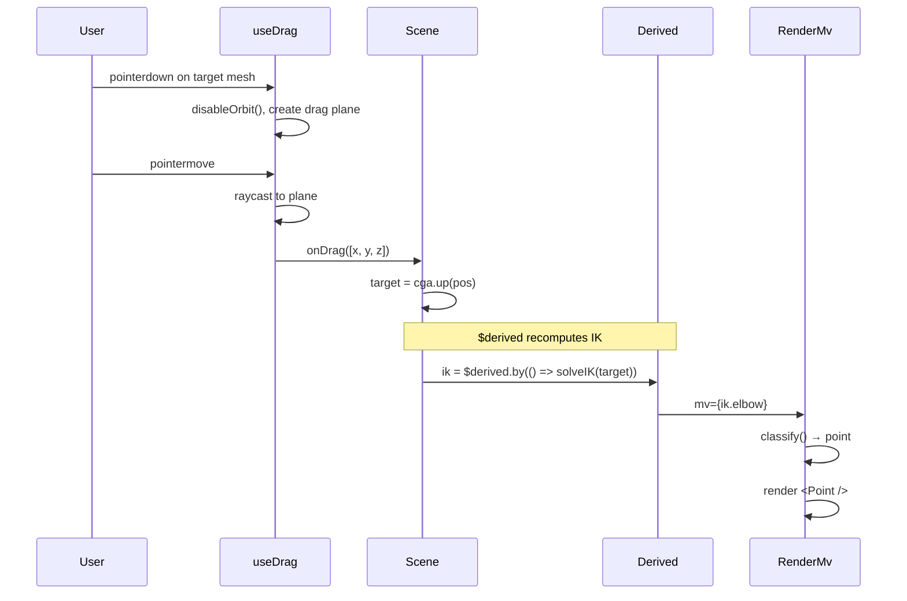

# Reactive Rendering Architecture

## Overview

This project uses a **Svelte 5 + Threlte** architecture that cleanly separates mathematical computation from visualization. The key patterns:

1. **Algebra modules** (CGA, PGA) are pure TypeScript with no rendering dependencies
2. **Svelte runes** (`$state`, `$derived`) drive reactive computation
3. **Geometry components** render multivectors without knowing what algebra created them
4. **Stores** coordinate global state (orbit controls, hover info)
5. **Composables** extract reusable logic (drag handling)

```
┌─────────────────────────────────────────────────────────────────┐
│                         Scene Component                          │
│  ┌─────────────┐    ┌──────────────┐    ┌──────────────────┐   │
│  │ $state(mv)  │───▶│  $derived()  │───▶│   <RenderMv />   │   │
│  │ (raw MV)    │    │  (IK, etc.)  │    │   (geometry)     │   │
│  └─────────────┘    └──────────────┘    └──────────────────┘   │
│        ▲                                         │              │
│        │                                         ▼              │
│  ┌─────────────┐                        ┌──────────────────┐   │
│  │  useDrag()  │◀───────────────────────│   T.Mesh events  │   │
│  │ (composable)│                        │   (click/drag)   │   │
│  └─────────────┘                        └──────────────────┘   │
└─────────────────────────────────────────────────────────────────┘
```

## Architecture Layers

### 1. Algebra Layer (`src/algebra/`)

Pure TypeScript modules that know nothing about rendering:

```
src/algebra/
├── cga.ts          # CGA algebra setup + basis elements
├── cgaHelpers.ts   # CGA operations (up, down, classify, meet, etc.)
├── pga.ts          # PGA algebra setup + basis elements
├── pgaHelpers.ts   # PGA operations (point, plane, classify, etc.)
├── types.ts        # Shared TypeScript types
├── cga.test.ts     # Vitest tests for CGA
└── pga.test.ts     # Vitest tests for PGA
```

Key design: Helpers are attached to `bs.helpers` so multivectors can classify themselves:

```typescript
// In cga.ts
bs.helpers = createCgaHelpers({ no, ni, e1, e2, e3 });

// Any MV can now call:
const primitive = myMv.classify();  // Returns { type: 'point', coords: [...] } etc.
```

### 2. Geometry Layer (`src/geometry/`)

Algebra-agnostic Svelte components that render geometric primitives:

```
src/geometry/
├── RenderMv.svelte    # Main component - classifies MV and dispatches
├── Point.svelte       # Sphere at position
├── Circle.svelte      # MeshLine circle
├── Sphere.svelte      # Transparent sphere
├── Plane.svelte       # Disk with normal orientation
├── Segment.svelte     # Line between two points
└── ...
```

**RenderMv** is the bridge: it calls `mv.classify()` and renders the appropriate component:

```svelte
<script>
  let { mv } = $props();
  const primitive = $derived(mv?.classify?.() ?? null);
</script>

{#if primitive?.type === 'point'}
  <Point position={primitive.coords} />
{:else if primitive?.type === 'circle'}
  <Circle center={primitive.center} radius={primitive.radius} normal={primitive.normal} />
{/if}
```

### 3. Scene Layer (`src/scenes/`)

Svelte components that compose algebra + geometry:

```
src/scenes/
├── AllSlidesApp.svelte      # Main app with slide navigation
├── Slide20Refactored.svelte # Forward kinematics
├── Slide24Refactored.svelte # Serial robot IK (draggable)
├── Slide30Refactored.svelte # Circle-circle intersection
├── PgaDemo.svelte           # PGA planes + meet point
└── ...
```

### 4. Stores (`src/stores/`)

Global reactive state using Svelte stores:

```typescript
// orbitControl.ts - coordinates drag and orbit
export const orbitEnabled = writable(true);
export function disableOrbit() { orbitEnabled.set(false); }
export function enableOrbit() { orbitEnabled.set(true); }

// hoverInfo.ts - manages hover/pin info display
export const hoverInfo = derived(...);
export function pinHoverInfo(id, getter) { ... }
```

### 5. Composables (`src/composables/`)

Reusable logic extracted from components:

```typescript
// useDrag.svelte.ts - handles 3D drag interactions
const drag = useDrag({
  getPosition: () => cga.down(target) ?? [0, 0, 0],
  onDrag: (pos) => { target = cga.up(pos); }
});
```

Note: Uses `.svelte.ts` extension to enable Svelte runes (`$state`).

## Data Flow Example

Here's how a draggable robot arm works:



## Key Patterns

### 1. State as Raw Multivectors

```typescript
// Use $state.raw for multivector state (MV has no reactivity internally)
let target = $state.raw(cga.up([0.5, 0.8, 0]));

// Derived computations recalculate automatically
const ik = $derived.by(() => {
  const S0 = no.sub(ni.smul(0.5 * rho ** 2)).dual();
  const S1 = target.sub(ni.smul(0.5 * l ** 2)).dual();
  const C = cga.meet(S0, S1);
  // ... more IK math
  return { elbow, endpoint, angles };
});
```

### 2. Algebra-Agnostic Geometry

Geometry components never import algebra modules:

```svelte
<!-- Point.svelte - just renders a sphere at [x,y,z] -->
<script>
  let { position, radius = 0.05, color = 0x000000 } = $props();
</script>

<T.Mesh {position}>
  <T.SphereGeometry args={[radius, 16, 16]} />
  <T.MeshBasicMaterial {color} />
</T.Mesh>
```

### 3. Classification at the Boundary

The only place algebra meets rendering is in `RenderMv`:

```typescript
// In RenderMv.svelte
const primitive = $derived(mv?.classify?.() ?? null);
// primitive is now a plain object: { type: 'circle', center: [...], radius: 1.5, normal: [...] }
```

### 4. Composables for Shared Behavior

```typescript
// useDrag.svelte.ts extracts ~80 lines of drag logic
export function useDrag(options: UseDragOptions): UseDragReturn {
  const { camera, renderer } = useThrelte();
  let isDragging = $state(false);
  // ... raycasting, plane intersection, orbit control
  return { onPointerDown, onPointerMove, onPointerUp, isDragging };
}

// Usage in scene (4 lines instead of 30+)
const drag = useDrag({
  getPosition: () => cga.down(Y) ?? [0, 0, 1],
  onDrag: (pos) => { Y = cga.up(pos); }
});
```

## File Structure

```
paparazzi/
├── src/
│   ├── algebra/           # Pure math (CGA, PGA)
│   │   ├── cga.ts         # CGA setup
│   │   ├── cgaHelpers.ts  # CGA operations
│   │   ├── pga.ts         # PGA setup
│   │   ├── pgaHelpers.ts  # PGA operations
│   │   └── *.test.ts      # Vitest tests
│   ├── geometry/          # Rendering components
│   │   ├── RenderMv.svelte
│   │   ├── Point.svelte
│   │   ├── Circle.svelte
│   │   └── ...
│   ├── primitives/        # Type definitions
│   │   └── types.ts       # GeoPrimitive, Coords3D, etc.
│   ├── scenes/            # Demo scenes
│   │   ├── AllSlidesApp.svelte
│   │   └── Slide*.svelte
│   ├── stores/            # Global state
│   │   ├── orbitControl.ts
│   │   └── hoverInfo.ts
│   ├── composables/       # Reusable logic
│   │   └── useDrag.svelte.ts
│   ├── basisSet.js        # Core GA operations
│   └── main.ts            # Entry point
├── docs/
│   ├── cga-cheatsheet.md
│   ├── pga-cheatsheet.md
│   └── store-based-rendering.md (this file)
└── package.json
```

## Testing

Tests use Vitest and focus on algebra correctness:

```bash
npm run test      # Watch mode
npm run test:run  # Single run
```

Example test:

```typescript
describe('CGA Points', () => {
  it('round-trips point coordinates', () => {
    const coords: Coords3D = [1.5, -2.3, 0.7];
    const pt = cga.up(coords);
    const back = cga.down(pt);
    expect(back![0]).toBeCloseTo(coords[0]);
    expect(back![1]).toBeCloseTo(coords[1]);
    expect(back![2]).toBeCloseTo(coords[2]);
  });
});
```

## Running the Demo

```bash
npm run dev
# Open http://localhost:5173
```

Use the slide navigation to browse demos:
- **Slide 20/22**: Forward kinematics (CGA)
- **Slide 24/38**: Inverse kinematics with dragging (CGA)
- **Slide 30**: Circle-circle intersection (CGA)
- **PGA Demo**: Three planes meeting at a point (PGA)
