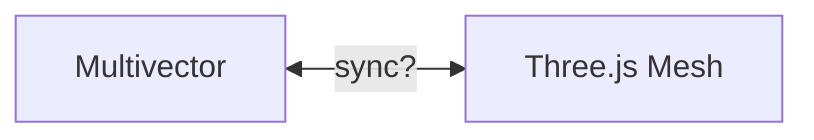
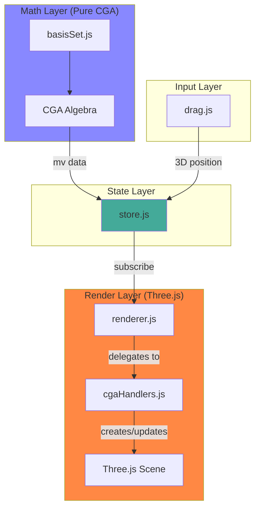
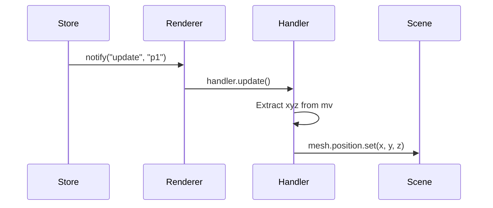
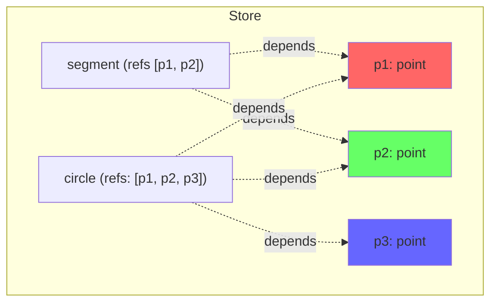

# Store-Based Rendering

## Overview

This update introduces a layered architecture that cleanly separates mathematical computation from visualization. The key insight: the store is algebra-agnostic, ie it just holds entities with arbitrary data. Only the handlers know about CGA math.

## The Problem: Two-Way Binding

Previously, we faced the classic two-way binding problem:



**Issues with direct binding:**
- **Circular updates**: Changing the mesh position should update the multivector, but updating the multivector should also update the mesh. Who's in charge?
- **Derived entities**: A circle through 3 points depends on those points. When a point moves, the circle must recalculate.
- **Mixed concerns**: Math code was tangled with rendering code.

## The Solution: Unidirectional Data Flow



**The key principle**: Data flows in one direction. User input → Store → Rendering.

## New Files

### `store.js` The Single Source of Truth

The store is deliberately simple and knows nothing about Multivectors or Three.js
- Holds entities with arbitrary properties
- Tracks dependencies between entities
- Notifies subscribers when things change

```javascript
// Example: Adding a point
store.add({
  id: "p1",
  type: "point",
  mv: up(1, 0, 0),  // Store doesn't know this is a multivector
  color: 0xff0000
});

// Updating cascades to dependents automatically (eg, line segments or circles)
store.update("p1", { mv: up(2, 0, 0) });
```

### `renderer.js` The Bridge

Subscribes to store changes and delegates to type-specific handlers:



### `cgaHandlers.js` CGA Three.js Translation

This is the **only place** that knows about both CGA and Three.js:

```javascript
// Knows how to extract 3D coords from CGA point
function pointXYZ(mv) {
  const XScalarNi = -mv.scalarProduct(cga.ni);
  return {
    x: mv.basisSVal("e_1") / XScalarNi,
    y: mv.basisSVal("e_2") / XScalarNi,
    z: mv.basisSVal("e_3") / XScalarNi
  };
}

// Knows how to embed 3D coords into CGA
function up(x, y, z) {
  const euclidean = cga.bs.multiVector({ e_1: x, e_2: y, e_3: z });
  const rSq = x*x + y*y + z*z;
  return cga.n0.add(euclidean).add(cga.ni.smul(0.5 * rSq));
}
```

### `drag.js` Input Without Algebra

The drag controller is also algebra-agnostic. It:
1. Raycasts to find which entity was clicked
2. Projects mouse movement onto a drag plane
3. Reports the 3D position via callback

The **consumer** (demo code) converts 3D coordinates to CGA:

```javascript
enableDragging(canvas, camera, renderer,
  // This callback runs when dragging
  (entityId, pos) => store.update(entityId, { 
    mv: up(pos.x, pos.y, pos.z)  // 3D to CGA happens here
  })
);
```

## Dependency Tracking

When entities reference other entities, updates cascade automatically:



When `p1` is dragged:
1. Store updates `p1`
2. Store notifies: `update("p1")`
3. Store looks up dependents of `p1` → `{segment, circle}`
4. Store notifies: `update("segment")`, `update("circle")`
5. Handlers recalculate derived geometry

## Simplified Usage Example

```javascript
import { createStore } from "./store.js";
import { createRenderer } from "./renderer.js";
import { createCGAHandlers } from "./cgaHandlers.js";

// Set up layers
const cga = setupCGA();
const { handlers, up } = createCGAHandlers(cga);
const store = createStore();
const renderer = createRenderer(scene, store, handlers);

// Add entities (store doesn't care what 'mv' means)
store.add({ id: "p1", type: "point", mv: up(1, 0, 0), color: 0xff0000 });
store.add({ id: "p2", type: "point", mv: up(0, 1, 0), color: 0x00ff00 });
store.add({ type: "segment", refs: ["p1", "p2"] });

// Updates flow automatically
store.update("p1", { mv: up(2, 0, 0) });  // segment updates too!
```

See paparazzi/store-demo.html and paparazzi/src/example/storeDemo.js for the main entry points

`npm run dev` and goto http://localhost:5173/store-demo to see it running